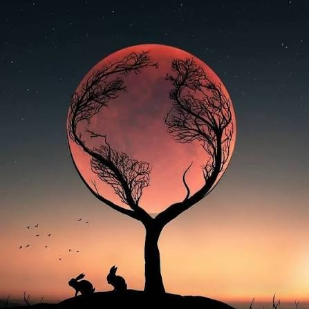
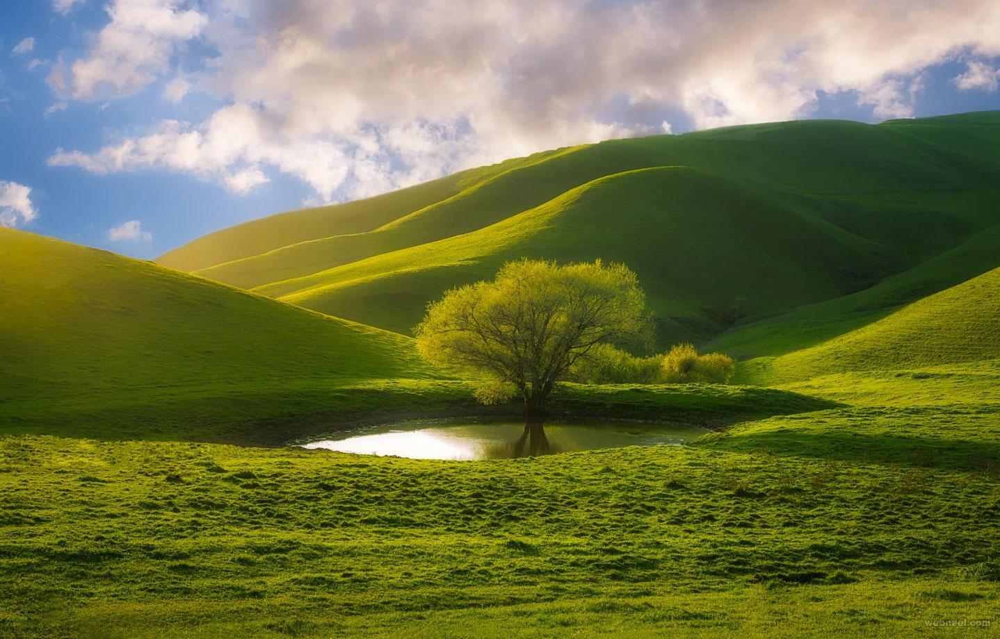
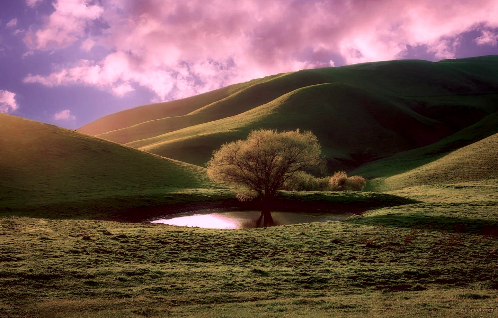

# Fast Reinhard Color Transfer

An optimized, vectorized Python implementation of the **Reinhard Color Transfer** algorithm based on the seminal paper [*Color Transfer between Images* (Reinhard et al., 2001)](https://www.cs.tau.ac.il/~turkel/imagepapers/ColorTransfer.pdf). 

This project transfers the aesthetic color palette, mood, and tonal distribution from a **Source image** to a **Target image** while preserving the target's original structural details and textures.

---

## 📸 Visual Demonstration

| Source (Color Palette) | Target (Original Image) | Result (Transferred Style) |
| :---: | :---: | :---: |
| `source_image.jpg` | `target_image.jpg` | `modified_target_image.jpg` |
|  |  |  |

---

## ⚡ Key Features

- **Fast & Vectorized**: Leverages NumPy array broadcasting and OpenCV's optimized C++ routines (`cv2.meanStdDev`) for near-instant processing.
- **Decoupled Luminance and Chrominance**: Performs statistical distribution alignment in the CIELAB color space to eliminate color artifacts and cross-channel bleed.
- **Numerical Stability**: Safeguarded against division by zero ($\epsilon = 10^{-5}$) and arithmetic overflow/underflow through `float32` intermediate computation.
- **Minimal Dependencies**: Requires only standard computer vision packages: OpenCV and NumPy.

---

## 🔬 How the Algorithm Works (Step-by-Step)

The core idea proposed by Reinhard et al. is that an image's overall color mood and dynamic contrast can be modeled by the **first and second statistical moments** (mean and standard deviation) of its color distribution—provided those statistics are calculated in an **uncorrelated color space**.

```
+--------------------+       +--------------------+
|  Source Image      |       |  Target Image      |
|  (BGR, uint8)      |       |  (BGR, uint8)      |
+---------+----------+       +---------+----------+
          |                            |
          v                            v
+--------------------+       +--------------------+
|  Convert to LAB    |       |  Convert to LAB    |
|  (cv2.COLOR_BGR2LAB)       |  (float32 precision)
+---------+----------+       +---------+----------+
          |                            |
          v                            v
+--------------------+       +--------------------+
| Compute Mean (μ_s) |       | Compute Mean (μ_t) |
|  & Std Dev (σ_s)   |       |  & Std Dev (σ_t)   |
+---------+----------+       +---------+----------+
          \                            /
           \                          /
            v                        v
        +--------------------------------+
        |   Apply Statistical Transfer   |
        |  R = ((T - μ_t) * (σ_s / σ_t)) |
        |               + μ_s            |
        +---------------+----------------+
                        |
                        v
        +--------------------------------+
        | Clip to [0, 255] & uint8 Cast  |
        +---------------+----------------+
                        |
                        v
        +--------------------------------+
        |  Convert Back: LAB -> BGR      |
        |  (cv2.COLOR_LAB2BGR)           |
        +---------------+----------------+
                        |
                        v
        +--------------------------------+
        |   Save Modified Output Image   |
        +--------------------------------+
```

### 1. Why CIELAB instead of RGB / BGR?
In RGB or BGR color spaces, the red, green, and blue color channels are strongly correlated. Modifying the red channel without compensating in green or blue causes severe unnatural color shifts.

The **CIELAB ($L^*a^*b^*$)** color space solves this by decorrelating light intensity from color information:
- **$L$ (Luminance / Lightness)**: Encodes brightness and structural details, matching human visual perception.
- **$a$**: Position along the green-to-red axis.
- **$b$**: Position along the blue-to-yellow axis.

By performing transfer in $L^*a^*b^*$, we can match the colors and lighting independently without cross-channel distortion.

---

### 2. Step 1: Reading Images and Converting to CIELAB
Images are read using OpenCV into the default BGR `uint8` format:
```python
source_lab = cv2.cvtColor(source_img, cv2.COLOR_BGR2LAB)
target_lab = cv2.cvtColor(target_img, cv2.COLOR_BGR2LAB).astype(np.float32)
```
- The target image is cast to `np.float32`. This step is critical: calculating differences and scale factors on 8-bit unsigned integers (`uint8`) would cause underflow (negative numbers wrapping around to 255) and overflow.

---

### 3. Step 2: Statistical Extraction (Mean & Standard Deviation)
For each channel $c \in \{L, a, b\}$, we compute the mean $\mu^{(c)}$ and standard deviation $\sigma^{(c)}$:
```python
def get_mean_and_std(x):
    mean, std = cv2.meanStdDev(x)
    return mean.flatten(), std.flatten()

source_mean, source_std = get_mean_and_std(source_lab)
target_mean, target_std = get_mean_and_std(target_lab)
```
- **Mean ($\mu$)**: Represents the average tone/brightness for that channel.
- **Standard Deviation ($\sigma$)**: Represents the dynamic range and spread of colors/contrast.

---

### 4. Step 3: Statistical Color Distribution Alignment
For every channel $c \in \{L, a, b\}$ and every pixel $(x, y)$, the transfer is formulated mathematically as:

$$I_{\text{result}}^{(c)}(x, y) = \left( I_{\text{target}}^{(c)}(x, y) - \mu_{\text{target}}^{(c)} \right) \cdot \left( \frac{\sigma_{\text{source}}^{(c)}}{\sigma_{\text{target}}^{(c)} + \epsilon} \right) + \mu_{\text{source}}^{(c)}$$

Where:
1. **Centering**: Subtract $\mu_{\text{target}}^{(c)}$ to shift the target channel's distribution to a zero mean.
2. **Scaling**: Multiply by the ratio $\frac{\sigma_{\text{source}}^{(c)}}{\sigma_{\text{target}}^{(c)} + \epsilon}$. If the source image has higher contrast or wider color variance, this stretches the target's variation accordingly. An epsilon $\epsilon = 10^{-5}$ prevents division by zero in homogeneous regions.
3. **Shifting**: Add $\mu_{\text{source}}^{(c)}$ to center the resulting distribution around the source's average color and lightness.

In Python, this is executed across all channels simultaneously using vectorized broadcasting:
```python
scale = source_std / (target_std + 1e-5)
result_lab = ((target_lab - target_mean) * scale) + source_mean
```

---

### 5. Step 4: Value Clipping & Quantization
Because statistical scaling can push pixel intensities outside the standard displayable range, values must be clamped to $[0, 255]$ and cast back to `uint8`:
```python
result_lab = np.clip(result_lab, 0, 255).astype(np.uint8)
```

---

### 6. Step 5: Converting Back to BGR
Finally, the modified $L^*a^*b^*$ array is converted back to BGR color space for saving or rendering:
```python
output_img = cv2.cvtColor(result_lab, cv2.COLOR_LAB2BGR)
```

---

## 📂 Project Structure

```text
Fast-reinhard-color-transfer/
├── main.py                    # Complete transfer pipeline implementation
├── source_image.jpg           # Reference image providing the color palette
├── target_image.jpg           # Target image to receive the color transfer
├── modified_target_image.jpg  # Generated output image
└── README.md                  # Project documentation and algorithm walkthrough
```

---

## 🚀 Getting Started

### Prerequisites

Ensure you have Python 3.8+ installed along with `opencv-python` and `numpy`:

```bash
pip install opencv-python numpy
```

### Running the Script

1. Place your reference color image as `source_image.jpg`.
2. Place the image you want to modify as `target_image.jpg`.
3. Run the script:

```bash
python main.py
```

The transformed result will be saved automatically in the same directory as `modified_target_image.jpg`.

---

## 📚 References

- **Eng. Ahmed Ibrahim**: Video tutorial and explanation on Reinhard Color Transfer — [Watch on YouTube](https://youtu.be/-IaBjbRuqpI?si=EMoOBb08ae3B57az)
- **Original Paper**: Reinhard, E., Adhikhmin, M., Gooch, B., & Shirley, P. (2001). *Color transfer between images*. IEEE Computer Graphics and Applications, 21(5), 34-41.
- **OpenCV Documentation**: [Color conversions with `cv2.cvtColor`](https://docs.opencv.org/master/d8/d01/group__imgproc__color__conversions.html)
